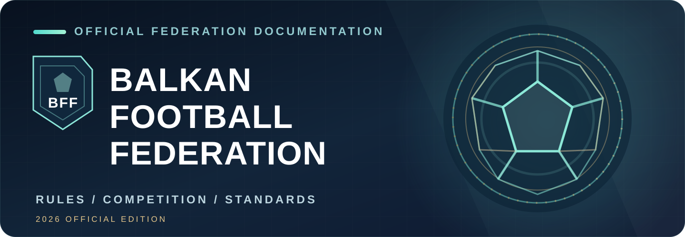

# BFF Official Rulebook

**Balkan Football Federation · Rules & Regulations**

*The governing regulations for players, club owners, referees, and staff across BFF competitions.*

---

> [!IMPORTANT]
> **Participation means acceptance of these regulations.** Every registered member is expected to understand and follow the rulebook. BFF Management may amend the regulations through official federation channels.

## At a glance

| ⚽ Match rules | ⏱️ Time & scheduling | 🏟️ Clubs & contracts |
| :--- | :--- | :--- |
| **4v4** match format | **20 minutes** regular time | **15 players** maximum per club |
| **2 players** minimum per team | **2 × 5 minutes** extra time when a winner is required | **10 seasons** maximum contract |
| **3–0** forfeit if minimum is not met | **4 penalties** per team, then sudden death | **30 days** minimum as club owner |
| **No replays** for referee mistakes | **24 hours** for scheduling and normal rescheduling | **2 TF = 1 Robux** |
| Referee approves stadium conditions | **12 hours** minimum notice for forced rescheduling | Owners may play **if registered** |
| **1 hour** maximum warm-up | Match changes require approval | Club locks require **League Staff** review |

> [!WARNING]
> **Doxxing carries an immediate permanent BFF ban.** There is no warning requirement. Division Staff and higher-ranking authorized officials may investigate match results, misconduct, eligibility, and other federation matters.

## Contents

| Section | What it covers |
| :--- | :--- |
| [01 · General Regulations](#1-general-regulations) | Conduct, authority, integrity |
| [02 · Match Regulations](#2-match-regulations) | Format, match time, referees, stadiums |
| [03 · Scheduling & Rescheduling](#3-match-scheduling--rescheduling) | 24-hour and 12-hour requirements |
| [04 · Club Regulations](#4-club-regulations) | Ownership, eligibility, resignations |
| [05 · Registration & Transfers](#5-squad-registration--transfers) | Squad limits, contracts, TF, locks |
| [06 · Kits & Equipment](#6-kits--equipment) | Kit conflicts, captain armbands |
| [07 · Discipline & Suspensions](#7-suspensions--disciplinary-actions) | Prohibited conduct, bans, appeals |
| [08 · Referee Regulations](#8-referee-regulations) | Referee responsibilities and reports |
| [09 · Staff & Investigations](#9-staff-authority--investigations) | Division Staff powers and reviews |
| [10 · Final Provisions](#10-final-provisions) | Application and future changes |

---

## 1. General Regulations

### 1.1 · General Conduct

Every BFF member must treat others with respect and maintain professional, sportsmanlike conduct. Racism, discrimination, harassment, threats, bullying, and abusive behavior are prohibited.

Cheating, exploiting, using unauthorized modifications, and intentionally abusing game mechanics are not permitted. All participants must follow the [Roblox Community Standards](https://en.help.roblox.com/hc/en-us/articles/203313410-Roblox-Community-Standards) and applicable platform terms.

### 1.2 · League Authority

**Division Staff and higher-ranking authorized officials** may investigate matches, results, registrations, club activities, disciplinary incidents, and other matters affecting BFF.

Authorized staff may request relevant evidence, hear from involved parties, review match recordings, and take or recommend appropriate action. Decisions must be grounded in the evidence and federation regulations.

### 1.3 · Manipulation & Misconduct

Match fixing, falsifying results, manipulating registrations, submitting false evidence, and attempting to improperly influence league officials are prohibited.

Confirmed misconduct may result in suspensions, removal from a competition, or permanent exclusion from BFF.

[↑ Back to contents](#contents)

---

## 2. Match Regulations

### 2.1 · Match Format

BFF official matches use a **4v4 format**. A team may field no more than four players on the pitch and must have at least **two eligible players** to participate.

If a team cannot meet the two-player minimum, the opposing team receives a **3–0 forfeit victory**. If neither side meets the minimum, the Division Staff Department will determine the appropriate outcome.

### 2.2 · Match Duration

| Stage | Regulation |
| :--- | :--- |
| Regular time | **20 minutes** |
| Extra time | **Two periods of 5 minutes**, when a winner is required |
| Initial shootout | **4 penalties per team** |
| Still tied after four each | **Sudden-death penalties** until a winner is determined |

Extra time and penalties apply when a competition requires a winner. League fixtures that permit draws end after regular time unless competition rules specify otherwise.

### 2.3 · Minimum Players & Forfeits

Teams must maintain at least two eligible players throughout the match. If a team falls below this minimum and cannot restore it, the referee must stop play.

The default outcome is a **3–0 defeat** for the team failing the requirement. The Division Staff Department may investigate exceptional circumstances before confirming the result.

### 2.4 · Referee Authority

An authorized referee controls the match, enforces the rules, and may issue match-related warnings, yellow cards, and red cards. Players and team officials must respect referee decisions.

### 2.5 · Referee Mistakes

> [!NOTE]
> **Referee mistakes do not justify a replay.** Incorrect calls, missed fouls, or controversial decisions do not by themselves invalidate a match.

Division Staff or higher authorities may still investigate referee misconduct, match manipulation, or serious regulatory violations. Starting an investigation does not automatically change the result.

### 2.6 · Stadium Conditions

The referee must assess the stadium before kickoff and decide whether it is suitable for an official fixture. Major technical problems, unsuitable playing conditions, or an unfair advantage may justify delaying or preventing kickoff.

Both clubs must comply with the referee's stadium decision.

### 2.7 · Warm-Up Period

Teams may warm up for a maximum of **one hour** before the match. Clubs must nevertheless be ready at the agreed kickoff time. Warm-ups do not authorize an unapproved delay.

[↑ Back to contents](#contents)

---

## 3. Match Scheduling & Rescheduling

### 3.1 · Match Scheduling

Every official fixture must be scheduled at least **24 hours before kickoff**. Both teams must be informed of the date and time, and club representatives must communicate the details to their players.

### 3.2 · Normal Rescheduling

A normal rescheduling request must be made at least **24 hours before the original kickoff**. The change requires authorization from the appropriate league officials. Neither club may unilaterally change a confirmed fixture.

### 3.3 · Forced Rescheduling

Forced rescheduling is reserved for exceptional circumstances and requires a valid reason. The request must be submitted at least **12 hours before the original kickoff** and approved by **Division Staff or higher-ranking officials**.

Requests outside this notice period may be refused.

### 3.4 · Failure to Attend

Clubs must arrive with at least two eligible players. Failure to meet the minimum results in a **3–0 forfeit defeat**. Repeated unjustified absences may lead to additional administrative sanctions.

| Request | Minimum advance notice | Approval |
| :--- | :--- | :--- |
| Schedule a match | **24 hours** | Official competition scheduling |
| Normal reschedule | **24 hours** | Appropriate league officials |
| Forced reschedule | **12 hours** | Division Staff or higher |

[↑ Back to contents](#contents)

---

## 4. Club Regulations

### 4.1 · Club Ownership

Every club must have a recognized owner responsible for managing the club, maintaining accurate squad information, and cooperating with league officials.

### 4.2 · Owners Playing for Their Clubs

A club owner **may play for the club they own**, but only after completing official player registration. Owners remain subject to the same eligibility, squad limit, and disciplinary rules as other players.

### 4.3 · Ownership Resignation

An owner must hold the position for at least **30 days** before voluntarily resigning. Once the period has passed, the owner may submit a formal resignation.

Ownership changes and transfers require **League Staff Department** review and authorization. BFF Management may remove or replace an owner earlier in exceptional circumstances, including serious misconduct.

### 4.4 · Club Responsibilities

Clubs must follow schedules, maintain eligible squads, and ensure members comply with the rulebook. Deliberate misrepresentation or abuse of ownership authority may result in sanctions.

[↑ Back to contents](#contents)

---

## 5. Squad Registration & Transfers

### 5.1 · Maximum Squad Size

> [!IMPORTANT]
> **A club may register no more than 15 players.** Registered owners who also play count toward this limit.

A club must release or transfer players before registering replacements if the full 15-player allocation is occupied.

### 5.2 · Player Registration

Players must be officially registered before participating in competitive matches. Fielding unregistered or otherwise ineligible players is prohibited and may result in sanctions, including forfeiture.

### 5.3 · Player Contracts

The maximum recognized contract duration is **10 seasons**. Longer agreements are invalid unless the federation formally amends the rule. Players and clubs must honor recognized agreements and refer disputes to the **League Staff Department**.

### 5.4 · Club Locks

Any club-lock case must be reviewed by the **League Staff Department**. Locks must comply with the rules and may not be used to unfairly restrict or punish players. The department will decide whether a disputed lock is justified.

### 5.5 · Transfer Funds (TF)

**TF** is the BFF transfer-related unit. Its stated conversion rate is:

### 2 TF = 1 Robux

TF may be purchased only through officially authorized BFF systems and methods allowed by Roblox. Only confirmed transactions are recognized. Falsified balances, fraudulent transactions, and exploitation are prohibited.

### 5.6 · Transfers

All transfers must respect registration, squad size, and contract rules. A transfer cannot take a club above **15 registered players**. Suspected fraudulent transfers may be investigated by Division Staff or higher officials.

[↑ Back to contents](#contents)

---

## 6. Kits & Equipment

### 6.1 · Kit Requirements

Teams must use appropriate, recognizable football kits. Offensive, racist, discriminatory, or otherwise prohibited content may not appear on kits. BFF may reject kits that fail these requirements.

### 6.2 · Kit Conflicts

The away team's kit must be clearly distinguishable from the home team's kit. If kits are identical or confusingly similar, **the away team must change**. The referee may delay kickoff until the problem is resolved.

### 6.3 · Captain Identification

Each team may designate a captain. Captains may wear an identifying armband, provided that it complies with kit standards. Captains are expected to communicate respectfully with match officials and are not exempt from sanctions.

[↑ Back to contents](#contents)

---

## 7. Suspensions & Disciplinary Actions

### 7.1 · General Disciplinary Policy

BFF may issue official warnings, temporary suspensions, permanent bans, or removal from federation activities according to the nature and seriousness of a confirmed violation.

### 7.2 · Racism & Discrimination

Racism, discriminatory statements, hate speech, and targeted harassment are prohibited. Confirmed violations may result in immediate suspension; serious or repeated misconduct may lead to permanent exclusion.

### 7.3 · Doxxing

> [!CAUTION]
> **Zero tolerance: confirmed doxxing results in an immediate permanent ban from BFF.** No previous warnings are required.

Publishing or maliciously exposing another person's private information, or threatening to do so, is prohibited. Serious cases may also be reported to Roblox through official reporting channels.

### 7.4 · Cheating & Exploiting

Cheating, exploiting game mechanics, or using unauthorized software to gain an unfair advantage is prohibited. Sanctions may include suspension, correction of improperly obtained results, or permanent exclusion.

### 7.5 · Suspension Restrictions

Suspended players cannot take part in official matches during their suspension. Suspended staff cannot perform official duties. Circumventing a suspension through alternative accounts is prohibited and may lead to further sanctions.

### 7.6 · Disciplinary Appeals

Members may appeal through the official BFF channels, providing a clear explanation and available evidence. Authorized officials will review the case.

An active suspension remains in force during the appeal unless an authorized official decides otherwise.

[↑ Back to contents](#contents)

---

## 8. Referee Regulations

### 8.1 · Referee Responsibilities

Referees must be impartial and apply the regulations consistently. They must verify player eligibility and numbers, inspect kits and stadium conditions, control matches, and report serious incidents.

### 8.2 · Match Reports

When required, referees must submit accurate match reports reflecting the final score and relevant disciplinary incidents. Deliberately falsifying a report is prohibited.

### 8.3 · Referee Misconduct

Division Staff or higher-ranking officials may investigate serious referee misconduct. Sanctions may include warnings, temporary removal from duties, or permanent dismissal.

**A refereeing mistake, on its own, does not authorize a match replay.**

[↑ Back to contents](#contents)

---

## 9. Staff Authority & Investigations

### 9.1 · Division Staff Authority

**Division Staff and every higher-ranking authorized level** may investigate any matter affecting BFF competitions and operations.

This includes match results, forfeits, scheduling, registrations, player eligibility, transfers, club conduct, refereeing, and other alleged violations. Officials may request evidence and recommend or take actions within their authority.

### 9.2 · Match Result Investigations

Result investigations may be initiated where there is reasonable suspicion of match manipulation, ineligible players, falsified reporting, or a significant breach of regulations.

Confirmed administrative violations may result in corrected records, forfeits, or disciplinary action. **Ordinary referee errors do not justify replays.**

### 9.3 · League Staff Department

The League Staff Department oversees league administration, including club locks, contract disputes, ownership changes, and regulatory compliance. It may coordinate with Division Staff and higher-ranking officials.

### 9.4 · Abuse of Authority

Staff must use their powers responsibly and impartially. Intentionally favoring clubs, manipulating outcomes, intimidating members, or interfering improperly with competitions is prohibited and may lead to removal from staff duties.

[↑ Back to contents](#contents)

---

## 10. Final Provisions

### 10.1 · Acceptance of Regulations

The rulebook applies to every player, owner, manager, referee, and staff member. Not having read the rules does not excuse noncompliance.

### 10.2 · Interpretation of Rules

Matters not expressly addressed here may be reviewed by the appropriate authorized department. Decisions must be reasonable, consistent, and supported by available evidence.

### 10.3 · Rulebook Amendments

BFF Management may modify, add, or remove rules when necessary. Changes must be announced through official channels. The latest published version is the applicable rulebook.

[↑ Back to contents](#contents)

---

### BALKAN FOOTBALL FEDERATION

**Integrity · Competition · Respect**

Official Rules & Regulations · 2026 Edition

© 2026 Balkan Football Federation. All rights reserved.

